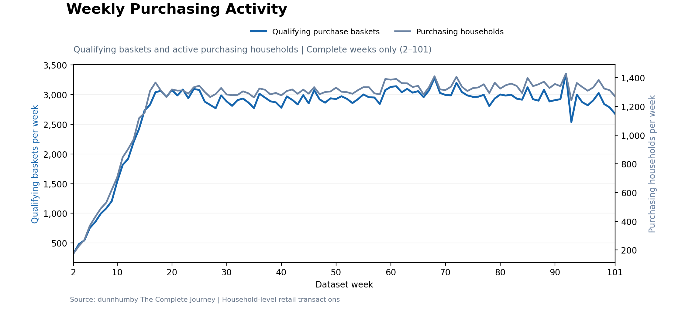
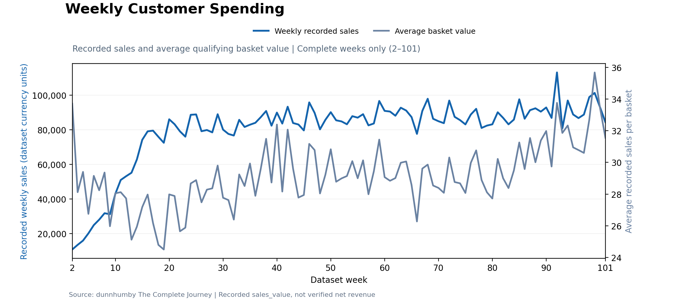
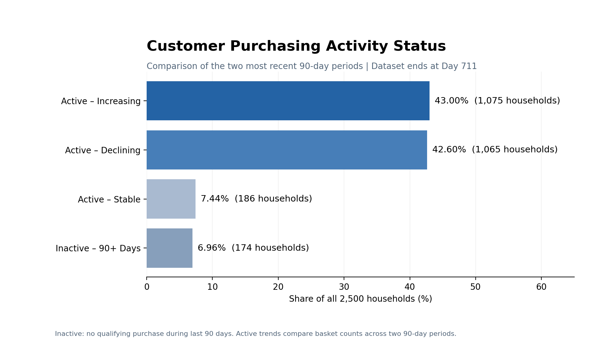

# Retail Customer Intelligence

## Customer Behavior, Loyalty & Value Analysis Using PostgreSQL

A SQL portfolio project analyzing real retail transaction data from the dunnhumby Complete Journey dataset.

### Tools

- PostgreSQL
- VS Code
- SQLTools
- Git & GitHub

### Project Status

Phase 1 — Business Understanding & Database Setup

### Dataset

dunnhumby — The Complete Journey

The original dataset files are excluded from this repository.

## Customer Purchasing Behavior

### Weekly Purchasing Activity

### Weekly Customer Spending

### Customer Purchasing Activity Status

## Objective 2: Identify Customer Value Drivers

This analysis examines how recorded sales are distributed
across households, what distinguishes higher-spending
customers, and how purchasing preferences differ.

### Key Findings

- **Revenue concentration:** The top 10% of households
  generated 34.29% of total recorded sales, while the
  top 20% contributed 53.05%.
- **Spending drivers:** Shopping frequency showed a
  stronger positive correlation with total spending
  (0.703) than average basket value (0.390).
- **Department preferences:** Grocery represented the
  largest share of spending for both high-value and
  lower-value households.
- **Category diversity:** High-value households purchased
  from an average of 16.14 departments, compared with
  11.31 for lower-value households.

### Business Implications

The retailer's sales are concentrated among a relatively
small group of households. Maintaining their engagement
may help protect sales, while encouraging repeat purchases
and broader department exploration among lower-spending
households may offer growth opportunities.

These findings describe historical purchasing patterns;
they do not establish causation or customer profitability.

### Visualizations

## Objective 3 — Identify Retention and Growth Opportunities

**Business decision:** Which households might benefit from differentiated engagement or retention initiatives?

Using Recency, Frequency and Monetary (RFM) scores, **2,500 purchasing households** were classified into six behavioral segments. These are relative, analysis-defined groups—not confirmed loyalty or churn labels.

### Key findings

- **Revenue concentration (Q7–Q8):** Champions account for **21.56% of households** but **48.05% of recorded sales**. Champions and Loyal Households together generate **62.76%**.
- **Inactivity warning signs (Q8):** **174 households** had no qualifying purchase for at least 90 days: **136 Hibernating** and **38 At-Risk**. The 90-day cutoff is an analytical assumption, not confirmed churn.
- **Growth candidates (Q9):** **328 households** (13.12%) met a defined RFM screening rule for relatively recent activity, lower frequency and moderate-or-higher spending; this is not a response prediction.
- **Promotional engagement (Q10, supporting):** Among campaign-assigned households, coupon redemption was highest for **Champions (43.56%)** and lowest for **Hibernating (1.49%)**. Assignment does not prove campaign exposure.
- **Purchasing after redemption (Q11, exploratory supporting):** For **432 households** with complete 30-day windows, average qualifying baskets changed from **9.04 to 8.90**, while average recorded spending changed from **297.31 to 305.34**. **Promotional engagement does not automatically correspond to a meaningful increase in purchasing.** These before/after results do not establish promotional impact.

### Visualizations

**Methodology and full findings:** [Methodology](docs/methodology.md) · [Business insights](docs/final_insights.md)
